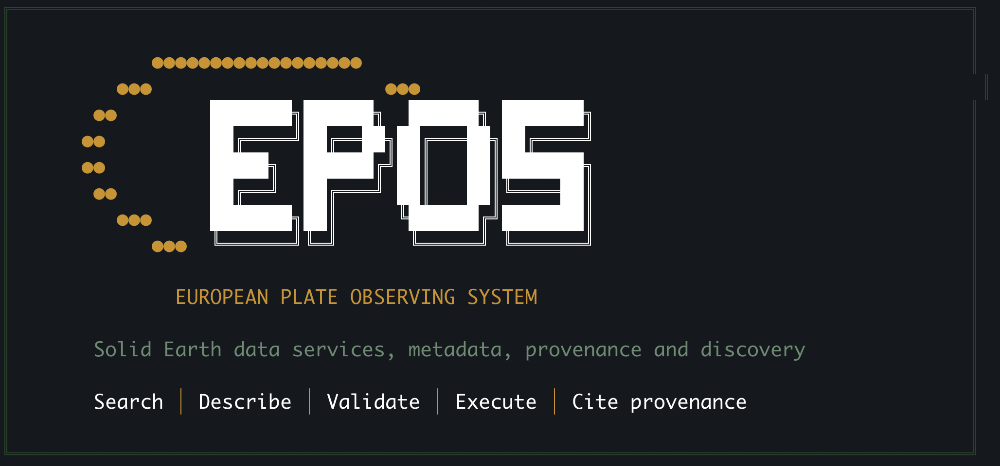

# EPOS Agent

<p align="center">
  
</p>

EPOS Agent is a model-agnostic terminal assistant for discovering and using EPOS Platform solid-Earth data services. It works with any Pi provider/model that supports tool calling and provides compact catalogue discovery, service execution, complete FDSN event downloads, provenance, and controlled workspace analysis.

## Quick start (Windows)

On Windows 10 or 11, open PowerShell and follow these steps to clone, install and start the agent:

1. **Clone the repository:**
```powershell
git clone https://github.com/EPOS-ERIC/epos-agent.git
cd epos-agent
```

2. **Run the installation:**
```powershell
.\install.ps1
```
*The installer requires PowerShell 5.7 or newer, an Internet connection and [winget](https://learn.microsoft.com/windows/package-manager/winget/) (included with Microsoft's App Installer).*

3. **Start the agent:**
Open a new PowerShell window and run:
```powershell
epos-agent
```

4. **Log in to your AI provider:**
Inside the Pi harness, run `/login` and follow the prompts. You don't need to configure a file to log in.

*(To use a different installation directory, set `$env:EPOS_INSTALL_ROOT = "C:\EPOS Agent"` before running `.\install.ps1`. Existing installations are updated automatically preserving your configuration and workspace data.)*

## Quick start (macOS/Linux)

The installer checks for Node.js (**22.19.0 or newer**), Python (**3.11 or newer**), Git and npm. If dependencies are missing, `install.sh` asks for permission and installs them using Homebrew (macOS) or your native package manager (Linux). For unattended installation, use `EPOS_AUTO_INSTALL=1`.

Open your terminal and follow these steps:

1. **Clone the repository:**
```bash
git clone https://github.com/EPOS-ERIC/epos-agent.git
cd epos-agent
```

2. **Run the installation:**
```bash
./install.sh
```
*The installer works in-place: it installs `pi coding agent`, the Python environments and all runtime data directly inside the cloned folder. It also creates a global `epos-agent` symlink so you can launch it from anywhere. During Installation you will be asked you computer password.*

3. **Start the agent:**
```bash
epos-agent
```

4. **Log in to your AI provider:**
Inside the Pi harness, run `/login` and follow the prompts. You don't need to configure a file to log in.

*(To install into a different directory, run `EPOS_INSTALL_ROOT=/other/path ./install.sh` from the repo. `EPOS_AGENT_ROOT` is not needed: the launcher always finds its root by following the symlink back to the repo.)*

## Configuration

Run `/login` inside the Pi harness and select your provider. Depending on the provider, you can choose:

- **Browser login:** Sign in to your provider account and authorize Pi through a browser or device flow. This may connect an eligible subscription.
- **API key:** Create an API key with your provider and enter it when prompted. API usage and billing are managed by the provider.

Available login methods and billing depend on the provider. Pi saves the resulting credential locally, so you don't need to edit a configuration file.

Alternatively, configure your provider credentials in `config/profile.env`. A template is available at `config/profile.env.example` with ready-to-use settings for Google Gemini, Anthropic Claude and OpenAI:

- **Google Gemini**: set `GEMINI_API_KEY`, `EPOS_PROVIDER=google`, `EPOS_MODEL=gemini-2.5-pro` (and optionally `EPOS_THINKING=medium`)
- **Anthropic Claude**: set `ANTHROPIC_API_KEY`, `EPOS_PROVIDER=anthropic`, `EPOS_MODEL=claude-sonnet-4-5`
- **OpenAI**: set `OPENAI_API_KEY`, `EPOS_PROVIDER=openai`, `EPOS_MODEL=gpt-4o`

Alternatively, you can leave them unset to use the current Pi configuration or export the standard environment variables directly.

## Token-efficient tools

Each user turn starts with only file reading and the internal `epos_load_tools` router. The model calls the router automatically to activate only the required capability. The EPOS MCP is initialized when the agent session starts and is the primary source for EPOS discovery, metadata and downloads; the specialist FDSN MCP remains on demand.

The catalogue adapter traverses all cached MCP result pages internally, deduplicates candidates and saves the full result list locally. The model receives up to 30 compact candidates; filters and cached pages expose the remainder. Metadata requests use a five-minute session cache. Chat shows relevant service or dataset titles grouped by scientific role. Discovery coverage is limited to the catalogue queries performed; it is not a guarantee of finding every scientifically relevant dataset. Pagination, batch downloads, file inspection and notebook assembly run without model calls between their mechanical steps.

## Guided study workflow

New studies follow this order: question → discovery → exact acquisition plan → user-interface approval → batch download → inspection and compatible visualization suggestions → selected visualization → reusable code and an executed Jupyter notebook. Missing essentials are collected in one compact question block. Each study is stored under `~/epos-agent/workspace/<study>-<timestamp>/`. The runtime requires recorded acquisition outcomes before inspection and a successful execution of the current `code/analysis.py` before notebook finalization.

Standard plots use the bundled `epos_viz` library and `code/visualization.json`. Static maps default to an offline coordinate grid; remote layers and interactive HTML are optional. Running the standard analysis automatically builds the notebook and executes it on a copy of the bundle with the current Python environment, comparing input hashes, counts, metrics and output names. Code or input changes invalidate prior verification. Pinned requirements come from actual imports and resolved features. This is a local reproduction check, not an installation test on every operating system.

## Security and runtime data

Sessions, cache, provenance logs, generated workspace files, Python environments, and authentication configuration are local runtime data and are excluded from Git. Provider-neutral usage metrics are appended to `logs/token-usage.jsonl` with model, active tools, token/cache counts and cost when available; prompts and scientific data are never logged there. Do not commit API keys, tokens, passwords, or `auth.json`.

## Download safety

Catalogue searches and distribution descriptions run without confirmation. Acquisition tools require an active study and a user-interface approval bound to the exact requests and resolved EPOS plans. FDSN detail calls and arbitrary public URL fetches are included; a metadata flag cannot bypass approval. The batch records downloaded, no-data, partial, access-denied, unavailable and failed outcomes. Repeating the batch reuses recorded results; `retryFailed: true` requests a new approval and retries unsuccessful transfers once while preserving earlier attempts. Restored sessions require new approval and fresh EPOS plans.

The retained-data budget is 1 GiB per study. The EPOS server additionally limits each response to 50 MiB; the wrapper checks the remaining study budget before copying the server artifact. FDSN enforces the remaining budget while writing records. These limits do not measure all wire traffic. Scientific completeness remains distinct from HTTP transfer completion. EPOS responses with pagination evidence are marked partial; arbitrary provider pagination is not automatically followed.

`metadata/` contains the approved plan, provenance, all acquisition attempts, inspection/analysis reports and the final inventory with sizes and SHA-256 hashes. Inventory records Python, available Pi/Git versions and source hashes. Large payloads and logs stay on disk. The approval checks govern acquisition tools; custom Python is not an operating-system network sandbox.

## Workflow verification

Runtime tests are in `tools/agent-runtime/tests/workflow.test.cjs`. They use the real TypeScript wrapper with a simulated Pi interface; the optional MCP test starts the real stdio server with offline HTTP fixtures, and the optional analysis test executes an actual notebook. No model API or live scientific service is needed.

Use a TypeScript 5.x development installation (the tests use its compiler API):

```bash
TYPESCRIPT_PATH=/path/to/typescript node --test tools/agent-runtime/tests/workflow.test.cjs
```

Set `MCP_TEST_PYTHON` to the installed MCP Python interpreter and `ANALYSIS_TEST_PYTHON` to the visualization interpreter with `requirements-core.txt` installed to enable both integration tests. Jupyter needs local loopback sockets. Without these variables, integration tests explicitly report skipped. Existing component tests remain:

```bash
PYTHONPATH=services/mcp-epos /path/to/mcp/python -m unittest discover -s services/mcp-epos/tests
/path/to/visualization/python -m unittest discover -s tools/visualization/tests
```

Compare `logs/token-usage.jsonl` across identical study requests and providers to measure token/call savings; the workflow checks do not establish equal scientific choices across models. No live multi-model benchmark is implied by the offline tests.

## Included FDSN service

The service in `services/mcp-fdsnws-event` is installed into a dedicated Python virtual environment by the platform installer. An explicit event `limit` is respected exactly. Without one, EPOS Agent adaptively partitions the requested time interval until every shard is below the provider result cap, deduplicates event IDs and verifies the oldest/newest boundaries before declaring the JSONL complete. Interrupted or unverifiable requests are retained as clearly marked `.partial.jsonl` files; chat receives the total and at most five samples.

Its existing tests can be run with:

```bash
cd services/mcp-fdsnws-event
./run_tests.sh
```

## License

See the license and attribution information in `services/mcp-fdsnws-event/LICENSE` and the upstream service documentation.
